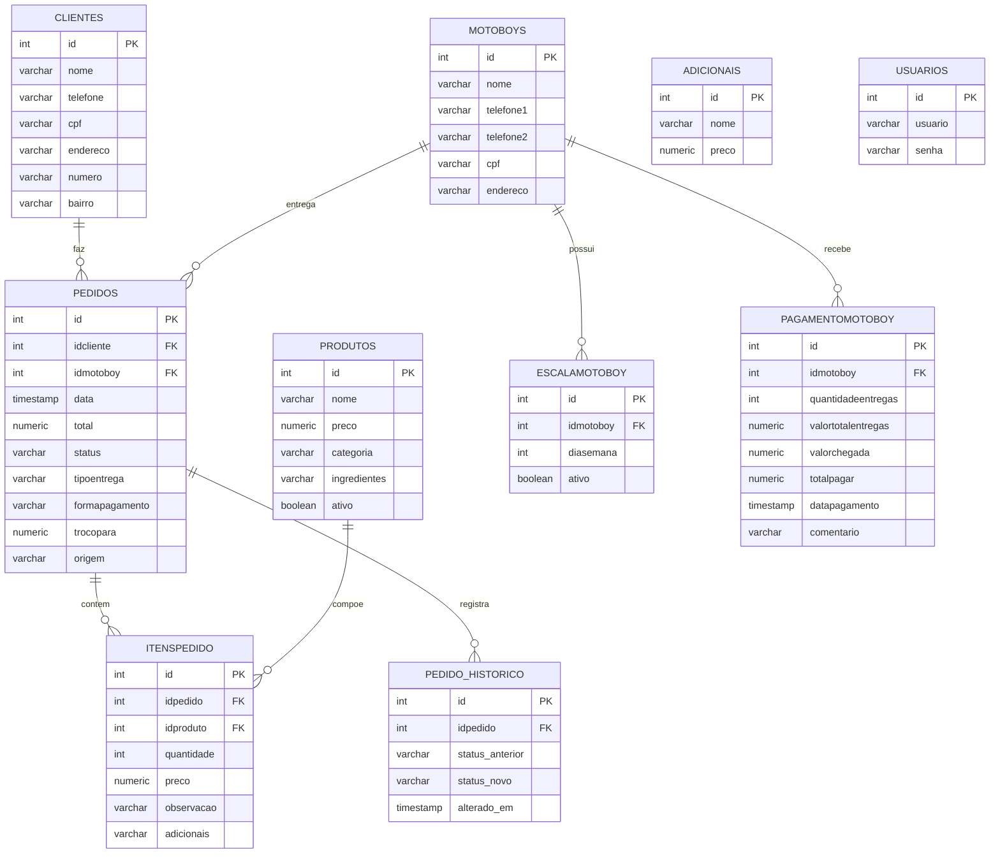

# Etapa 7 — Projeto do Banco de Dados (PIM IV)

**Disciplina:** Programação de Banco de Dados
**Projeto:** DevBurguer — Sistema Integrado de Gestão para Hamburgueria
**SGBD:** PostgreSQL (hospedado em nuvem; compatível com Supabase/Neon)

Este documento apresenta a estrutura completa do banco de dados do DevBurguer:
o modelo conceitual (MER), o modelo lógico, o modelo físico, o dicionário de
dados e a descrição das *procedures* e *triggers*. O banco é único e é
compartilhado pela API REST, pela aplicação Web e pelo aplicativo Mobile.

---

## 7.1 Justificativa da tecnologia

Optou-se por um banco de dados **relacional**, pois os dados do negócio
(clientes, produtos, pedidos, itens) são estruturados e fortemente
relacionados, dependendo de integridade referencial para manter a
consistência. Adotou-se o **PostgreSQL** por ser gratuito, de código aberto,
robusto, com suporte nativo a *procedures*, *triggers*, tipos `JSONB` e por ser
oferecido pelos principais serviços gerenciados de nuvem (Supabase, Neon,
Render), o que atende também à Etapa 8 (infraestrutura em nuvem).

---

## 7.2 Modelo Entidade-Relacionamento (MER)



As entidades **ADICIONAIS** (catálogo de opções) e **USUARIOS** (acesso ao
sistema) não possuem relacionamento direto com as demais e, por isso, aparecem
isoladas no diagrama.

---

## 7.3 Modelo Lógico

O modelo lógico descreve as tabelas, seus atributos e as chaves. As chaves
primárias (PK) identificam cada registro; as chaves estrangeiras (FK)
estabelecem os relacionamentos.

- **clientes** (**id** PK, nome, telefone, endereco, cpf, numero, bairro)
- **produtos** (**id** PK, nome, preco, categoria, ingredientes, ativo)
- **motoboys** (**id** PK, nome, endereco, telefone1, telefone2, cpf, numero, bairro)
- **usuarios** (**id** PK, usuario, senha)
- **adicionais** (**id** PK, nome, preco)
- **pedidos** (**id** PK, _idcliente_ FK→clientes, _idmotoboy_ FK→motoboys, data, total, status, tipoentrega, trocopara, formapagamento, origem, criado_em, atualizado_em)
- **itenspedido** (**id** PK, _idpedido_ FK→pedidos, _idproduto_ FK→produtos, quantidade, observacao, preco, adicionais)
- **escalamotoboy** (**id** PK, _idmotoboy_ FK→motoboys, diasemana, ativo)
- **pagamentomotoboy** (**id** PK, _idmotoboy_ FK→motoboys, quantidadeentregas, valortotalentregas, valorchegada, totalpagar, datapagamento, comentario)
- **pedido_historico** (**id** PK, _idpedido_ FK→pedidos, status_anterior, status_novo, alterado_em)

**Cardinalidades principais:** um cliente faz muitos pedidos (1:N); um pedido
contém muitos itens (1:N); cada item referencia um produto (N:1); um pedido
pode ter um motoboy (N:1); um motoboy possui muitas escalas e muitos
pagamentos (1:N).

---

## 7.4 Modelo Físico

O modelo físico corresponde à implementação real em PostgreSQL, com tipos de
dados, restrições e índices. O script completo está em
`database/devburguer_completo.sql`.

**Principais decisões físicas:**

- Chaves primárias `SERIAL` (auto-incremento).
- Valores monetários em `NUMERIC(10,2)` — precisão exata, sem erro de ponto flutuante.
- `BOOLEAN` para `ativo`; `TIMESTAMP` para datas.
- **Restrições de domínio (CHECK):** `status`, `tipoentrega` e `origem` só
  aceitam valores válidos do negócio; `preco >= 0`; `quantidade > 0`.
- **Unicidade de CPF:** índice único parcial, que impede CPF duplicado mas
  permite clientes de balcão sem CPF (regra RN07).
- **Índices** nas colunas mais consultadas (`status`, `data`, `categoria`,
  `idproduto`, `idpedido`) para acelerar relatórios e o cardápio.
- **Colunas de auditoria** (`criado_em`, `atualizado_em`) na tabela `pedidos`.

---

## 7.5 Dicionário de dados (resumo)

| Tabela | Finalidade | Destaques |
|--------|-----------|-----------|
| clientes | Cadastro dos clientes | CPF único (parcial) |
| produtos | Cardápio | `ativo` controla exibição; preço base das vendas |
| motoboys | Entregadores | Dois telefones de contato |
| usuarios | Acesso ao sistema desktop | Senha armazenada como hash |
| adicionais | Catálogo de adicionais dos lanches | Preço cobrado pelo servidor |
| pedidos | Pedido realizado | `status`, `origem` (Desktop/Site), auditoria |
| itenspedido | Itens de cada pedido | Preço gravado no momento da venda |
| escalamotoboy | Escala semanal dos motoboys | `diasemana` 0–6 |
| pagamentomotoboy | Pagamentos aos motoboys | Totais por período |
| pedido_historico | Auditoria de mudanças de status | Preenchida por trigger |

---

## 7.6 Procedures e Funções

Implementadas em `database/procedures/01_procedures.sql`. Encapsulam no banco as
regras e consultas reutilizadas pela API, pelo site e pelo mobile.

| Nome | Tipo | Finalidade |
|------|------|-----------|
| `fn_produtos_mais_vendidos(dias, limite)` | Função | Ranking dos mais vendidos no período (pedidos finalizados) |
| `fn_faturamento_periodo(inicio, fim)` | Função | Soma o faturamento dos pedidos finalizados entre duas datas |
| `fn_dashboard_dia(data)` | Função | Indicadores do dia: total, faturamento, ticket médio e contagem por situação |
| `fn_pagamento_motoboy(idmotoboy, inicio, fim, valor)` | Função | Calcula entregas e valor devido a um motoboy |
| `sp_atualizar_status_pedido(idpedido, novo)` | Procedure | Muda o status validando as transições permitidas do ciclo de vida |
| `fn_criar_pedido(idcliente, tipoentrega, pagamento, itens, origem, taxa)` | Função | Cria o pedido e seus itens em transação, calculando o total pelos preços do banco |

**Exemplo de uso:**

```sql
-- indicadores de hoje
SELECT * FROM fn_dashboard_dia();

-- aprovar um pedido do site (Aguardando -> Em Producao)
CALL sp_atualizar_status_pedido(42, 'Em Producao');
```

---

## 7.7 Triggers

Implementadas em `database/triggers/01_triggers.sql`. Executam automaticamente,
independentemente da aplicação que alterou os dados.

| Trigger | Evento | Ação |
|---------|--------|------|
| `trg_log_status` | `AFTER UPDATE OF status` em pedidos | Grava cada mudança de status em `pedido_historico` (auditoria) |
| `trg_item_preco` | `BEFORE INSERT` em itenspedido | Preenche o preço do item a partir do produto se não informado (anti-fraude) |
| `trg_bloqueia_delete_produto` | `BEFORE DELETE` em produtos | Impede excluir produto com vendas; obriga a inativar (regra RN04) |
| `trg_set_atualizado_em` | `BEFORE UPDATE` em pedidos | Atualiza o carimbo `atualizado_em` |

**Decisão de projeto:** optou-se por *não* recalcular o total do pedido via
trigger, porque o total inclui a taxa de entrega (que não é um item). O cálculo
do total fica concentrado na função `fn_criar_pedido` e na API, evitando
divergências.

---

## 7.8 Validação

Todos os scripts foram executados e testados em PostgreSQL 16. O script
completo (`database/devburguer_completo.sql`) roda do zero sem erros e cria
**10 tabelas, 10 rotinas e 4 triggers**. Os testes confirmaram: cálculo
correto do total (itens + taxa de entrega), bloqueio de transições de status
inválidas, registro automático no histórico, preenchimento automático do preço
e bloqueio da exclusão de produtos com vendas.
