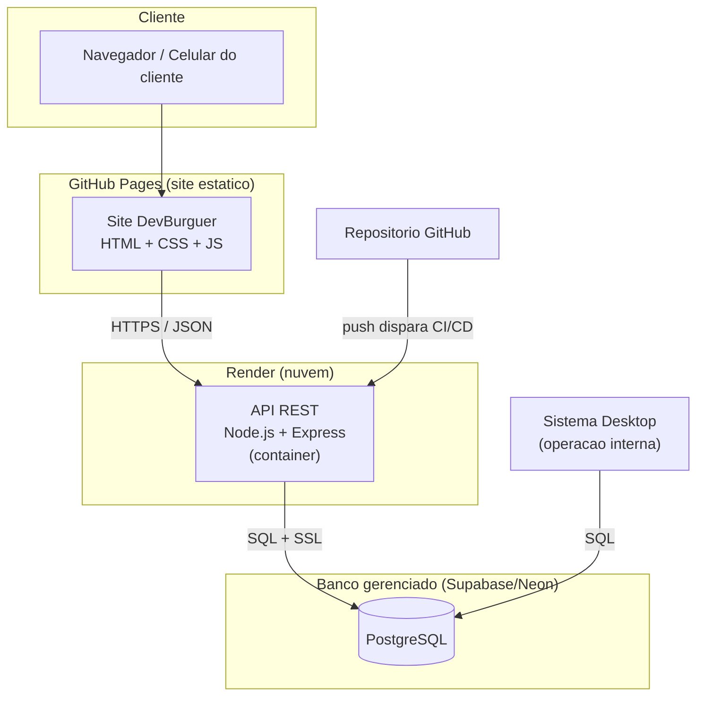
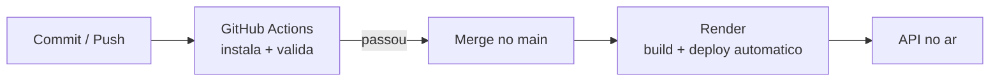

# Etapa 8 — Infraestrutura em Nuvem e DevOps (PIM IV)

**Disciplina:** Cloud Computing e DevOps
**Projeto:** DevBurguer — Solução tecnológica integrada

Esta etapa apresenta o plano de execução da infraestrutura em nuvem do
DevBurguer e as práticas de DevOps adotadas: arquitetura, serviços,
containers, pipeline CI/CD, monitoramento, escalabilidade e segurança.

---

## 8.1 Arquitetura em nuvem

A solução adota uma arquitetura distribuída, em que cada componente é
hospedado no serviço de nuvem mais adequado ao seu tipo, todos integrados por
HTTPS e compartilhando um único banco de dados.

**Fluxo:** o cliente acessa o site (GitHub Pages); o site chama a API REST
(Render); a API lê e grava no PostgreSQL gerenciado; o sistema desktop usa o
mesmo banco para a operação interna. Um `push` no GitHub dispara a validação
(CI) e o deploy automático (CD) da API.

---

## 8.2 Serviços utilizados

| Camada | Serviço | Papel |
|--------|---------|-------|
| Front-end (site) | **GitHub Pages** | Hospeda o site estático (pasta `docs/`), gratuito e com HTTPS |
| Back-end (API) | **Render** | Executa a API Node.js, com deploy automático a partir do GitHub |
| Banco de dados | **PostgreSQL gerenciado** (Supabase/Neon) | Armazena os dados, com backup e SSL |
| Versionamento / CI | **GitHub + GitHub Actions** | Guarda o código e executa a integração contínua |

A escolha por serviços gerenciados e de plano gratuito é adequada ao porte do
negócio (pequena hamburgueria) e ao contexto acadêmico, eliminando a
necessidade de administrar servidores.

---

## 8.3 Containers

A API foi containerizada com **Docker** (`DevBurguer-API/api/Dockerfile`),
garantindo que ela rode de forma idêntica em qualquer ambiente. A imagem parte
do `node:22-alpine` (enxuta), instala apenas as dependências de produção,
executa como usuário não-root e expõe a porta da aplicação. Um arquivo
`.dockerignore` evita copiar `node_modules`, `.env` e o histórico do Git para a
imagem.

Benefícios: portabilidade (“funciona na minha máquina” deixa de ser problema),
builds reproduzíveis e facilidade de escalar replicando o container.

---

## 8.4 Pipeline CI/CD

O projeto adota integração e entrega contínuas:

- **CI (Integração Contínua)** — `.github/workflows/ci.yml`: a cada `push` ou
  `pull request` no `main`, o GitHub Actions instala as dependências da API e
  verifica a sintaxe de todos os arquivos, barrando código quebrado antes do
  deploy.
- **CD (Entrega Contínua)** — o Render está configurado com *auto-deploy*:
  aprovada a CI e feito o merge no `main`, o Render reconstrói e publica a API
  automaticamente. O arquivo `render.yaml` descreve esse serviço como código.

---

## 8.5 Monitoramento

- **Logs de aplicação:** a API registra cada requisição e os erros no console,
  visíveis no painel de logs do Render em tempo real.
- **Health check:** a rota `/` responde com o status da API e é usada pelo
  Render para verificar se o serviço está saudável (`healthCheckPath`).
- **Métricas do provedor:** o Render exibe uso de CPU, memória e histórico de
  deploys; o provedor do banco exibe conexões ativas e consumo.

Como evolução, propõe-se um monitoramento de disponibilidade externo (ex.:
UptimeRobot) que avise caso a API fique fora do ar.

---

## 8.6 Escalabilidade

- **Back-end:** por ser *stateless* (não guarda estado em memória; tudo vai ao
  banco), a API pode escalar horizontalmente — basta subir mais réplicas do
  container atrás de um balanceador, recurso oferecido pelo Render nos planos
  pagos.
- **Banco de dados:** o PostgreSQL usa *connection pool*, reaproveitando
  conexões; provedores gerenciados permitem aumentar recursos conforme a
  demanda.
- **Site:** sendo estático e servido por CDN (GitHub Pages), escala
  praticamente sem limite.

---

## 8.7 Segurança

- **HTTPS** em todas as camadas (site, API e banco).
- **Conexão ao banco com SSL** obrigatório (`DB_SSL=true`).
- **Segredos fora do código:** credenciais ficam em variáveis de ambiente
  (`.env` local, ignorado pelo Git; e no painel do Render em produção).
- **CORS restrito:** em produção, a API aceita chamadas apenas do domínio do
  site (`CORS_ORIGIN`), em vez de liberar para todos.
- **Preço calculado no servidor:** impede manipulação de valores pelo cliente.
- **Princípio do menor privilégio:** o container roda como usuário não-root.

---

## 8.8 Artefatos entregues

| Arquivo | Finalidade |
|---------|-----------|
| `DevBurguer-API/api/Dockerfile` | Containeriza a API |
| `DevBurguer-API/api/.dockerignore` | Reduz e protege a imagem |
| `.github/workflows/ci.yml` | Pipeline de integração contínua |
| `render.yaml` | Infraestrutura da API como código |
